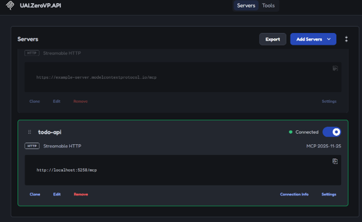
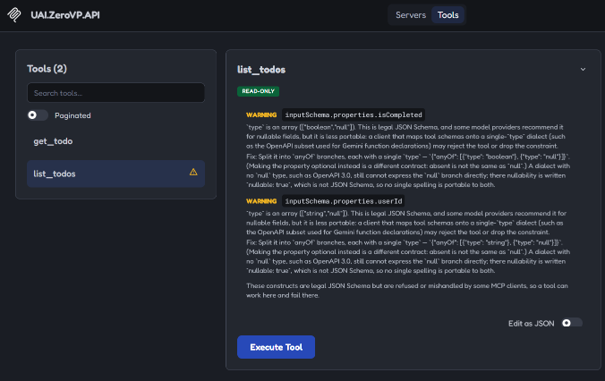
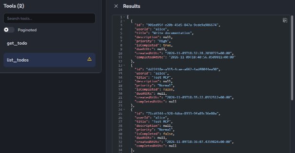
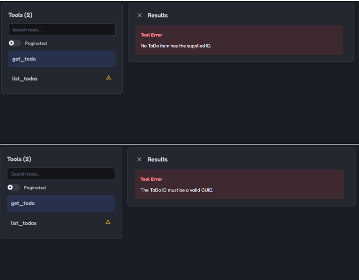
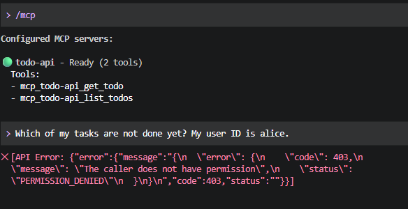
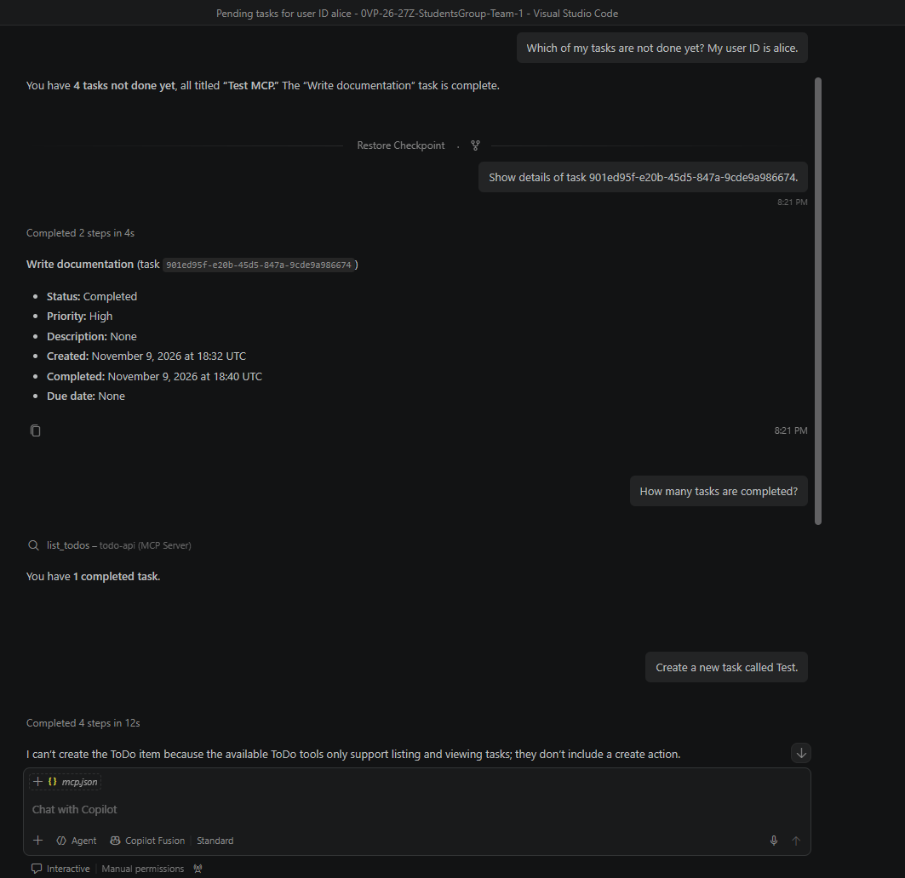

# MCP pro čtení úkolů

Model Context Protocol (MCP) umožňuje klientovi objevit a volat nástroje aplikace. ToDo API poskytuje dva nástroje pro čtení přes Streamable HTTP na `http://localhost:5258/mcp`. Spusťte API z kořene repozitáře příkazem `dotnet run --project src/UAI.ZeroVP.API` a použijte tuto adresu v klientovi MCP.

| Nástroj | Parametry | Výsledek |
|---|---|---|
| `list_todos` | Volitelné `isCompleted` (boolean) a `userId` (řetězec). | Pole úkolů se stejnými filtry a pořadím jako `GET /api/todos`. |
| `get_todo` | Povinné `id` (řetězec ve formátu GUID). | Jeden úkol. Neplatné nebo neznámé ID vrátí výsledek nástroje s `isError: true`. |

Úspěšný výsledek obsahuje JSON v textovém bloku MCP. Příklad pro `get_todo`:

```json
{
  "id": "b30c089b-a8cf-4891-8a20-cb8a6df04127",
  "userId": "demo",
  "title": "Vyzkoušet MCP",
  "description": null,
  "priority": "Normal",
  "isCompleted": false,
  "dueAtUtc": null,
  "createdAtUtc": "2026-11-09T08:00:00+00:00",
  "completedAtUtc": null
}
```

MCP je standardně zapnuté v prostředí Development a vypnuté v Production. Pro přepnutí použijte nastavení `Mcp:Enabled` nebo proměnnou prostředí `Mcp__Enabled`. Vypnutý endpoint vrací `404`.

**Pouze pro místní vývoj s testovacími daty.** MCP neověřuje uživatele a každý klient může vypsat všechny úkoly. Endpoint nevystavujte veřejně.

## Ruční testování

Postup ověřuje MCP server ručně na lokálně spuštěném API s testovacími daty.

### Příprava

1. Spusťte API: `dotnet run --project src/UAI.ZeroVP.API`.
2. Ve Swaggeru (`http://localhost:5258/swagger`) založte testovací úkoly pro uživatele `alice` a `bob` a jeden úkol uživatele `alice` označte za dokončený.

### MCP Inspector

Vyžaduje Node.js.

1. Spusťte `npx @modelcontextprotocol/inspector`. Pokud PowerShell blokuje skripty, použijte `npx.cmd`.
2. Otevřete odkaz z terminálu, klikněte na **Add Servers** a vyplňte ID `todo-api`, transport *Streamable HTTP* a URL `http://localhost:5258/mcp`. Poté zapněte přepínač serveru.



3. Na kartě **Tools** se zobrazí právě dva nástroje, `list_todos` a `get_todo`. Oba mají značku READ-ONLY.



4. Nástroje se volají tlačítkem **Execute Tool**. Argumenty lze zadat přepínačem **Edit as JSON**.

| Volání | Argumenty | Výsledek |
|---|---|---|
| `list_todos` | `{}` | všech 10 úkolů |
| `list_todos` | `{"isCompleted": true}` | 2 dokončené úkoly |
| `list_todos` | `{"userId": "alice"}` | 5 úkolů uživatele alice |
| `list_todos` | `{"isCompleted": true, "userId": "alice"}` | 1 úkol |
| `get_todo` | existující ID | daný úkol |
| `get_todo` | `00000000-0000-0000-0000-000000000000` | chyba „No ToDo item has the supplied ID.“ |
| `get_todo` | `abc` | chyba „The ToDo ID must be a valid GUID.“ |

Výsledky `list_todos` odpovídaly seznamu z `GET /api/todos`. Počty v tabulce platí pro naše testovací data.





### GitHub Copilot ve VS Code

Přidejte server do souboru `.vscode/mcp.json`. Složka `.vscode/` je v `.gitignore`, soubor se tedy nezapisuje do repozitáře:

```json
{ "servers": { "todo-api": { "type": "http", "url": "http://localhost:5258/mcp" } } }
```

V souboru klikněte na **Start**, otevřete Copilot Chat (`Ctrl+Alt+I`), přepněte režim na **Agent** a v seznamu nástrojů zkontrolujte, že `todo-api` nabízí dva nástroje. Každé volání nástroje je nutné povolit.

### Gemini CLI

Přidejte server do souboru `~/.gemini/settings.json`:

```json
{ "mcpServers": { "todo-api": { "httpUrl": "http://localhost:5258/mcp" } } }
```

Po spuštění `gemini` příkaz `/mcp` ukázal `todo-api` jako Ready se dvěma nástroji (`get_todo`, `list_todos`).



Dotazy se nepodařilo dokončit: přihlášení osobním účtem Google už Gemini CLI nepodporuje a Gemini API vrátilo s API klíčem chybu 403 (`PERMISSION_DENIED`) i na jednoduchý dotaz bez nástrojů. Příčina není v MCP serveru.

### Ukázkové dotazy a pozorování

Testováno v GitHub Copilot Chat (režim Agent).

| Dotaz | Zavolaný nástroj | Výsledek |
|---|---|---|
| „Which of my tasks are not done yet? My user ID is alice.“ | `list_todos` s `userId=alice` a `isCompleted=false` | Správně: 4 nedokončené úkoly. |
| „Show details of task 901ed95f-e20b-45d5-847a-9cde9a986674.“ | `get_todo` | Správně: úkol „Write documentation“. |
| „How many tasks are completed?“ | `list_todos` s `isCompleted=true` | Odpověděl 1, protože použil i `userId=alice` z předchozí otázky. |
| „How many tasks are completed in total, across all users?“ | `list_todos` s `isCompleted=true` | Správně: 2. |
| Žádost o vytvoření nebo smazání úkolu | žádný | Asistent úkol nevytvořil ani nesmazal, protože neexistuje nástroj pro zápis. |



**Co fungovalo:** asistent vybíral správný nástroj a správné argumenty a server je jen pro čtení.

**Pozorování:**

- Inspector u obou parametrů `list_todos` varuje, že typ je zapsaný jako pole (`["boolean","null"]`, `["string","null"]`). Je to platné JSON Schema, ale někteří klienti (například Gemini) ho mohou odmítnout nebo parametr ignorovat.
- Dotaz bez uvedení uživatele asistent filtroval podle ID z předchozí otázky. Popisy nástrojů to neovlivňují.

- Gemini CLI zaregistrovalo oba nástroje i přes varování Inspectoru o typu `["boolean","null"]`. Zda by Gemini parametry po úspěšném přihlášení správně použilo, jsme neověřili.

> **Pozor:** MCP endpoint nemá autentizaci a je určený pouze pro lokální vývoj. Nevystavujte ho veřejně.